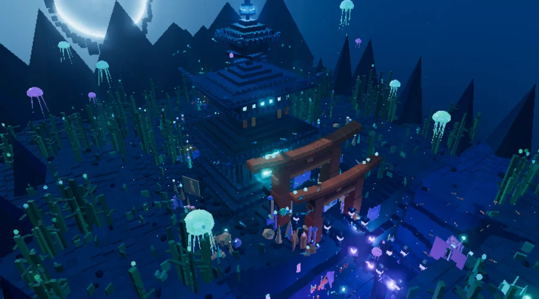
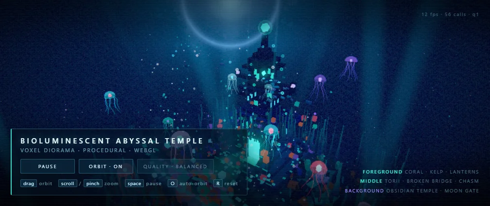

> **작성일:** 2026-11-10  
> **테스트 환경:** NVIDIA GeForce RTX 3090 (24GB VRAM) / 64GB DDR4 RAM / PCIe 4.0 NVMe SSD / Windows 11  
> **추론 엔진:** Strata v0.2.13.1 (Engine 0.1.59, CUDA 13)  
> **대상 모델:** Qwen3.8-Flash-Next (`IQ2_XS`, `IQ3_S`, `AD-405`)  
> **최종 선택 (2026-11-11):** `IQ3_S`로 확정, `AD-405`는 삭제 (4번 섹션에서 근거 정리)

---

## 1. 하드웨어 및 메모리 아키텍처

RTX 3090 (24GB VRAM)과 64GB 시스템 RAM 환경에서 대규모 MoE(Mixture of Experts) 모델인 Qwen3.8-Flash-Next를 구동하기 위한 계층적 메모리 배치 구조입니다.

```mermaid
flowchart TB
    subgraph GPU["NVIDIA GeForce RTX 3090 (24GB VRAM)"]
        Dense["Dense 어텐션 / KV 캐시 / MTP 드래프터 (~6.0 GiB)"]
        VCache["GPU 전문가 VRAM 캐시 (6,527 ~ 11,472 전문가, ~14.5 GiB)"]
    end

    subgraph Host["Host System (64GB RAM + Commit 확장)"]
        RCache["RAM 상주 전문가 (Pinned RAM, 0 ~ 35.82 GiB)"]
        OS["Windows 11 OS 및 여유 메모리 공간"]
    end

    subgraph Storage["NVMe SSD (PCIe 4.0)"]
        PLE["PLE n-gram 검색 테이블 (28.8 GB)"]
        SWAP["가상 메모리 확장 영역 (pagefile.sys, 32 ~ 64 GB)"]
    end

    GPU <-->|PCIe 4.0 x16 (26.8 GB/s)| Host
    Host <--> Storage
```

### 메모리 커밋 설정 (SSD 스래싱 방지)
- Windows 환경에서 대용량 메모리 고정(Pinned RAM) 할당 실패 및 SSD 강제 페이징을 방지하기 위해 가상 메모리를 32~64GB로 확장(커밋 한계 ~102GB 확보).
- `STRATA_RESIDENT_HEADROOM_GIB=4` 설정을 통해 35.82 GiB의 전문가 가중치를 물리 RAM에 100% 영구 상주시켜 SSD 읽기 횟수를 `files 0 blobs` (0회)로 유지.

---

## 2. 실제 테스트 모델 비교

동일 하드웨어(RTX 3090 24GB, 64GB RAM)에서 실제로 직접 적재하고 구동을 진행했던 3가지 모델의 실측 제원 및 성능 데이터입니다. 아래 `AD-405` 열은 삭제 전 실측 기록 그대로입니다.

| 항목 | Qwen3.8-Flash-Next IQ2_XS | Qwen3.8-Flash-Next IQ3_S | Qwen3.8-Flash-Next AD-405 |
| :--- | :---: | :---: | :---: |
| **파일 크기 (Weight Size)** | 68.0 GB | 77.9 GB (PLE 포함 83.6 GiB) | 117.3 GB |
| **평균 가중치 정밀도 (BPW)** | ~2.20 bpw | ~3.44 bpw | ~4.05 bpw |
| **VRAM 적재 전문가 수** | 11,472 (100%) | 7,674 | 6,527 |
| **RAM 상주 용량** | ~0 GB (RAM 여유) | 35.82 GiB (100% 상주) | ~58.0 GiB (물리 가용량 초과) |
| **SSD I/O 스필 여부** | 없음 (`0 reads`) | 없음 (`0 reads`) | **발생 (SSD 스트리밍 활성화)** |
| **토큰 생성 속도 (Decode)** | **60 ~ 95 tok/s** | **45 ~ 52.5 tok/s** | **22 ~ 44 tok/s** *(문맥 증가 시 ~12 tok/s)* |
| **프롬프트 처리 속도 (Prompt)** | ~180 - 220 tok/s | ~120 - 150 tok/s | ~70 - 95 tok/s |
| **최대 지원 문맥** | 256K | 131K | 131K |
| **장기 문맥 유지력 (50K+)** | 속도 저하 없음 | 속도 저하 없음 (일정 유지) | SSD 페이징 경합으로 감속 |
| **BF16 기준 지능 일치율** | 81.2% | 87.7% | 92.4% |
| **구동 특성 요약** | VRAM에 전량 적재되어 최고 속도 달성.<br>복잡한 수식/쉐이더에서 세부 정밀도 저하. | 24GB VRAM + 36GB RAM 조합의 최적 상주.<br>지연 없는 인메모리 추론 및 안정적 속도. | 고난도 설계 및 검증 코드 작성 능력 우수.<br>64GB RAM 한계로 대용량 작업 시 SSD 병목. |

---

## 3. 복셀 벤치마크 (`Voxel Bench`) 실시간 3D 비교

동일한 프롬프트인 **"Bioluminescent Abyssal Temple (생체발광 심해 사원 - 외부 모델/텍스처 없이 단일 WebGL/Three.js 기반 완전 절차적 3D 복셀 디오라마)"**를 주었을 때 `IQ3_S`와 `AD-405`가 각각 작성한 실제 동작 3D HTML 결과물을 실시간으로 비교합니다.

아래 뷰어에서 마우스 드래그로 궤도를 회전하거나 휠로 줌을 조작하며 양쪽 씬의 디테일과 퍼포먼스를 직접 확인해 보세요.

[[demo]]

> 🔗 **단독 전체화면 바로가기:**
> - [🕹️ Qwen3.8-Flash-Next IQ3_S 단독 씬 열기](iq3s.html)
> - [🕹️ Qwen3.8-Flash-Next AD-405 단독 씬 열기](ad405.html)

---

### 핵심 결과물 요약 비교

| 항목 | Qwen3.8-Flash-Next IQ3_S | Qwen3.8-Flash-Next AD-405 |
| :--- | :--- | :--- |
| **렌더링 캡처** |  |  |
| **코드 구조** | 단일 모놀리식 스크립트 (1,978 LOC) | 5개 분할 모듈 아키텍처 (2,353 LOC) |
| **드로우콜 최적화** | **수백 회 이상** (개별 박스 반복 인스턴싱) | **55 calls / 5,078 Tris** (7종 키트 사전 버퍼 병합) |
| **생체발광 유기체** | 직선형 고정 다리 해파리, 단순 원형 궤도 어군 | **7가닥×5마디 실시간 파동 촉수**, **70마리 Boids 어군** |
| **광원 및 블룸 제어** | 초기 광원 폭주로 블룸 화이트아웃 발생 (수동 보정) | NDC 화면 투영 면적 수학적 계산으로 **과노출 방지** |
| **HUD & 런타임 제어** | 텍스트 오버레이, Space(일시정지) | 글래스모피즘 HUD, 4단계 적응형 퀄리티 루프 (`q2`~`q0`) |

---

## 4. 최종 선택: `IQ3_S` 유지, `AD-405` 삭제

같은 프롬프트로 만든 두 결과를 놓고 품질과 속도를 함께 재보면 `IQ3_S`가 `AD-405`보다 만족스러웠습니다. 결과물 자체의 완성도가 앞섰을 뿐 아니라 생성 속도도 빨랐기 때문에, 이 환경에서는 `AD-405`를 올려 둘 이유가 없었습니다. 결국 로컬에서 `AD-405` 웨이트와 캐시를 삭제하고 `IQ3_S`만 남겼습니다.

| 판단 기준 | Qwen3.8-Flash-Next IQ3_S | Qwen3.8-Flash-Next AD-405 |
| :--- | :--- | :--- |
| **결과물 만족도** | 복셀 밀도·구도·화면 안정성에서 체감 우위. 블룸만 보정하면 그대로 쓸 수 있는 완성도 | 촉수·Boids 어군은 정교하지만 후반부 화면이 흐려지고 씬 전체가 단조로움 |
| **토큰 생성 속도** | **45 ~ 52.5 tok/s**, 50K+ 문맥에서도 일정 | 22 ~ 44 tok/s, 문맥이 늘면 **~12 tok/s**까지 하락 |
| **입출력 병목** | `files 0 blobs` — 인메모리 추론 | 64GB RAM 초과로 **SSD 스트리밍 활성** |
| **수정·재실행 비용** | 단일 파일 1,978 LOC — 바로 고쳐서 다시 실행 | 5분할 모듈 2,353 LOC — 루프가 무거움 |
| **BF16 지능 일치율** | 87.7% | 92.4% |

`AD-405`의 지능 일치율이 숫자로는 앞선다는 점은 인정합니다. 다만 그 정밀도를 위해 117.3 GB가 넘는 가중치를 64GB RAM 위에 올려야 하고, 그 결과 SSD 스트리밍이 켜지면서 장문 컨텍스트에서 속도가 12 tok/s 부근까지 내려갑니다. 체감 품질·반응 속도·반복 작업 비용을 합산하면 이 환경에서는 손해를 감수하고 유지할 값어치가 없었습니다.

삭제로 117.3 GB가 비었고, 남은 `IQ3_S`는 Pinned RAM 35.82 GiB에 100% 상주(`STRATA_RESIDENT_HEADROOM_GIB=4`, `files 0 blobs`)한 상태로 계속 굴러갑니다. 이후 실험은 전부 `IQ3_S` 기준이고, 위 비교 표와 두 개의 씬은 삭제 전 기록으로 이 글에 그대로 남겨 둡니다. RAM 96 GB 이상 환경에서는 `AD-405`를 다시 검토할 여지가 있습니다.
